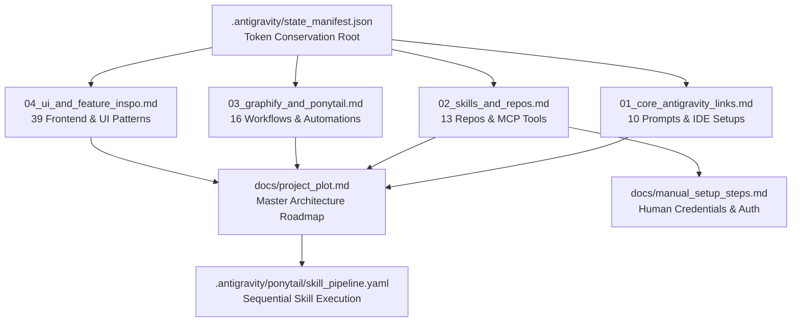

# Graphify Visual Dependency Map

## Graph Node Topology
1. **Token Root**: `state_manifest.json` acts as pre-flight gatekeeper.
2. **Intelligence Vaults**: 4 clustered files containing all 78 indexed links.
3. **Master Plot**: Consolidates intelligence into an actionable implementation blueprint.
4. **Execution Router**: Ponytail enforces sequential, token-minimized skill triggering.