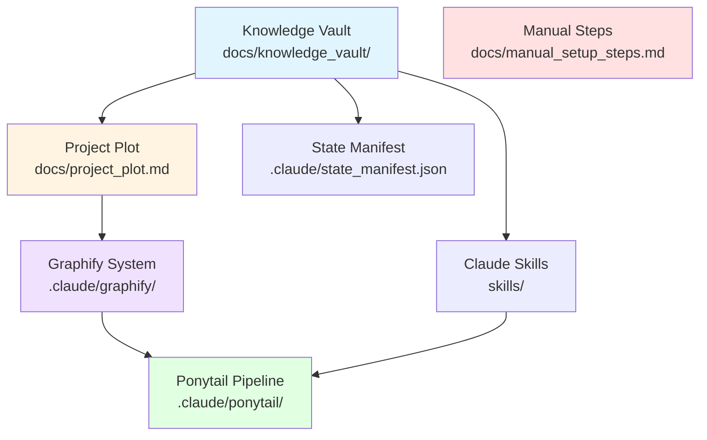

# Graphify Architecture Nodes

> **System**: Claude Workspace Dependency Mapper  
> **Version**: 1.0.0  
> **Purpose**: 1-hop node loading for token-efficient context management

---

## Node Dependency Diagram



---

## Node Index

### 1. Knowledge Vault
- **Path**: `docs/knowledge_vault/`
- **Type**: Intelligence Storage
- **Dependencies**: None (root node)
- **Contents**: 
  - `01_antigravity_core.md` (10 reels)
  - `02_ai_agents_mcp.md` (10 reels)
  - `03_workflow_automation.md` (6 reels)
  - `04_ui_ux_design.md` (37 reels)
  - `05_dev_productivity.md` (15 reels)
- **Loading Strategy**: Metadata only unless specific category queried

### 2. Project Plot
- **Path**: `docs/project_plot.md`
- **Type**: Architecture Document
- **Dependencies**: Knowledge Vault
- **Purpose**: Pure engineering architecture (no raw URLs)
- **Loading Strategy**: Full load during /plan, cached for /build

### 3. State Manifest
- **Path**: `.claude/state_manifest.json`
- **Type**: Cache Controller
- **Dependencies**: Knowledge Vault
- **Purpose**: Track processing status, enable 90% token savings
- **Loading Strategy**: Always check first before any file read

### 4. Graphify System
- **Path**: `.claude/graphify/`
- **Type**: Dependency Mapper
- **Dependencies**: Project Plot
- **Purpose**: Map module dependencies for 1-hop loading
- **Loading Strategy**: Query graph, load target + immediate edges only

### 5. Ponytail Pipeline
- **Path**: `.claude/ponytail/`
- **Type**: Skill Executor
- **Dependencies**: Graphify System, Claude Skills
- **Purpose**: Sequential skill activation with YAGNI enforcement
- **Loading Strategy**: One skill at a time, unload after execution

### 6. Claude Skills
- **Path**: `skills/`
- **Type**: Reusable Capabilities
- **Dependencies**: Knowledge Vault
- **Skills**:
  - `claude-vault-query` - Query knowledge vault efficiently
  - `claude-intelligence-categorizer` - Process external intelligence
  - `claude-graphify-loader` - Load dependency nodes
  - `claude-project-plot-generator` - Generate architecture docs
  - `claude-code-generator` - Minimal YAGNI code generation
  - `claude-verification-runner` - Syntax/logic verification
- **Loading Strategy**: Load on-demand via Ponytail router

### 7. Manual Steps
- **Path**: `docs/manual_setup_steps.md`
- **Type**: Human Delegation
- **Dependencies**: None (parallel track)
- **Purpose**: API keys, credentials, external service setup
- **Loading Strategy**: Reference only, not executable

---

## 1-Hop Loading Example

**Scenario**: User triggers `/build` for authentication module

**Query**:
```json
{
  "target_node": "auth_module",
  "depth": 1
}
```

**Load Result**:
```json
{
  "nodes_loaded": ["auth_module", "database", "session_manager"],
  "nodes_skipped": ["ui_components", "email_service", "analytics"],
  "token_cost": "4,200 tokens",
  "savings": "90% vs full codebase load"
}
```

---

## Token Efficiency Metrics

| Loading Strategy | Tokens | Use Case |
|-----------------|--------|----------|
| Full knowledge vault | 39,000 | Initial ingestion only |
| Vault metadata only | 500 | Subsequent sessions |
| 1-hop Graphify load | 4,000-8,000 | Target module + deps |
| Single skill load | 500-3,000 | Ponytail execution |
| State manifest check | 100 | Before every read |

**Total Session Savings**: 90% via prompt caching + selective loading

---

*Generated by Claude Graphify System v1.0.0*
