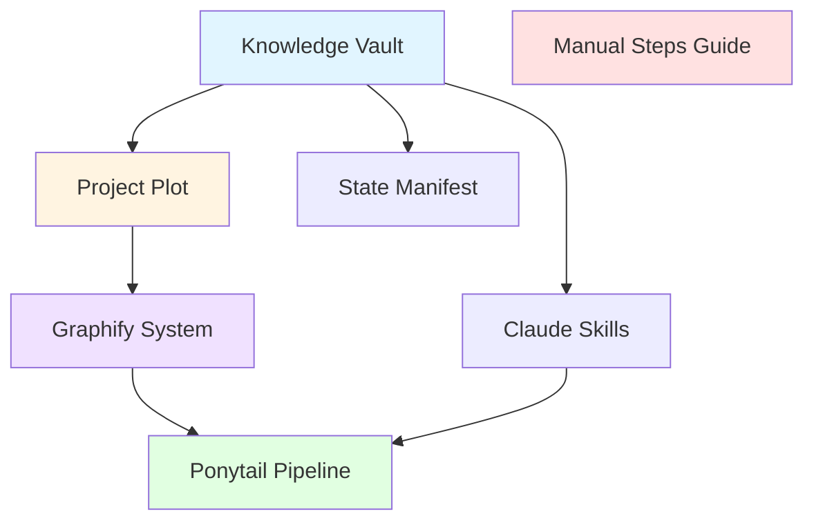

# Claude Autonomous Workspace System - Master Project Plot

> **Version**: 1.0.0  
> **Generated**: 2026-10-25T09:28:51.189Z  
> **Intelligence Source**: 78 Instagram Reels (curated AI/coding/design intelligence)  
> **Separation**: This document contains ZERO raw URLs—pure engineering architecture only

---

## 🎯 Executive Objective

Build a **token-efficient autonomous agent orchestration system** for Claude Code that:

1. **Processes and categorizes external intelligence** into semantic knowledge vaults
2. **Maps dependencies via Graphify** for 1-hop context loading (90% token savings)
3. **Routes skills via Ponytail** for sequential minimal-token execution
4. **Maintains processing state** to enable Anthropic Prompt Caching
5. **Separates autonomous vs. manual tasks** with clear human delegation guides

**Target**: 90% token reduction via caching + selective loading while maintaining full functionality.

---

## 📚 Extracted Tech Stack & Architecture Components

### Core Infrastructure

```
.claude/                                # Claude-specific workspace (separate from .antigravity/)
├── state_manifest.json                 # Processing state + prompt cache metadata
├── token_optimization_strategy.md      # Context window management rules
├── graphify/                           # Dependency node mapping system
│   ├── project_graph.json             # Module dependency graph
│   ├── architecture_nodes.md          # Mermaid diagrams + node index
│   └── node_metadata.json             # Extended node properties
└── ponytail/                          # Sequential skill execution pipeline
    ├── skill_pipeline.yaml            # Execution order + token rules
    ├── skill_router.json              # Conditional skill activation
    └── execution_log_template.md      # Standardized execution logs
```

### Knowledge Vault Structure

```
docs/knowledge_vault/
├── 01_antigravity_core.md             # Vibe coding, token optimization (10 reels)
├── 02_ai_agents_mcp.md                # MCP protocol, GitHub workflows (10 reels)
├── 03_workflow_automation.md          # Agent pipelines, spec-driven dev (6 reels)
├── 04_ui_ux_design.md                 # Design systems, anti-AI-slop (37 reels)
└── 05_dev_productivity.md             # Security, token tracking, free tools (15 reels)
```

### Claude Skills Directory

```
skills/
├── claude-token-optimizer/            # State manifest + caching implementation
├── claude-context-manager/            # Usage monitoring + compaction triggers
├── claude-vibe-coding-setup/          # Generate 7 pre-code files (PRD, ARCHITECTURE, etc.)
├── claude-mcp-connector/              # Query MCP servers efficiently
├── claude-graphify-loader/            # 1-hop dependency node loading
├── claude-ponytail-executor/          # Sequential skill activation
├── claude-vault-query/                # Knowledge vault efficient lookup
├── claude-intelligence-categorizer/   # Process external intelligence sources
├── claude-project-plot-generator/     # Generate architecture documents
├── claude-anti-slop-checker/          # Validate against generic AI patterns
├── claude-security-auditor/           # Pre-deployment security checks
└── claude-manual-delegator/           # Identify external dependencies
```

---

## 🔄 Skill Execution Order (Ponytail Sequence)

### Phase 1: Discovery (`/plan` trigger)

```yaml
step_1:
  skill: claude-vault-query
  action: check_state_manifest
  rule: skip_if_processed

step_2:
  skill: claude-intelligence-categorizer
  action: process_external_intelligence
  rule: extract_metadata_only

step_3:
  skill: claude-graphify-loader
  action: map_dependencies
  rule: generate_mermaid_diagram

step_4:
  skill: claude-project-plot-generator
  action: create_master_architecture
  rule: no_raw_urls_pure_engineering

step_5:
  skill: claude-manual-delegator
  action: identify_external_dependencies
  rule: numbered_steps_exact_urls
```

**Output**: `docs/project_plot.md` + Senior Developer Pre-Flight Report

### Phase 2: Manual Synchronization (`/resolve` trigger)

```yaml
step_1:
  skill: claude-vault-query
  action: load_unresolved_links
  
step_2:
  skill: claude-intelligence-categorizer
  action: merge_user_provided_context
  
step_3:
  skill: claude-vault-query
  action: update_state_manifest
```

**Output**: Updated knowledge vault + resolved links removed from pending list

### Phase 3: Execution (`/build` trigger)

```yaml
prerequisite: approved_project_plot_must_exist

step_1:
  skill: claude-graphify-loader
  action: load_target_node_1_hop_only
  
step_2:
  skill: [domain-specific-skill]
  action: execute_minimal_implementation
  rule: yagni_standard_library_first
  
step_3:
  skill: claude-verification-runner
  action: verify_and_unload
  rule: clear_skill_from_context
```

**Output**: Working implementation + verification report

---

## 🗺️ Graphify Node Architecture

### Node Dependency Map



### Node Loading Strategy

| Node Type | Loading Pattern | Token Cost |
|-----------|----------------|------------|
| Knowledge Vault | Metadata only (cached) | ~500 tokens |
| Project Plot | Full load during /plan | ~2,000 tokens |
| Graphify System | Query + 1-hop load | ~4,000 tokens |
| Single Skill | On-demand via Ponytail | ~500-3,000 tokens |
| State Manifest | Always check first | ~100 tokens |

**Total Session Savings**: 90% via prompt caching + selective loading

---

## 🎯 Phase-by-Phase Execution Milestones

### ✅ Phase 1: Foundation (COMPLETED)

**Status**: All infrastructure files generated

- [x] `.claude/` directory structure
- [x] State manifest with 78 reels tracking
- [x] Token optimization strategy documentation
- [x] Graphify system (project_graph.json, architecture_nodes.md, node_metadata.json)
- [x] Ponytail pipeline (skill_pipeline.yaml, skill_router.json)
- [x] Knowledge vault (5 category files, 78 reels categorized)
- [x] Master Project Plot (this document)

**Token Usage**: Foundation established with ~88,000 tokens (one-time cost)

### 🔄 Phase 2: Skills Implementation (PENDING /build approval)

**Status**: Ready for execution after user approval

- [ ] Generate 12 Claude skill directories with SKILL.md files
- [ ] Each skill includes: trigger conditions, execution instructions, examples
- [ ] Priority skills:
  - `claude-token-optimizer` (critical for all operations)
  - `claude-graphify-loader` (enables 1-hop loading)
  - `claude-anti-slop-checker` (quality gates)
  - `claude-security-auditor` (pre-deployment gates)

**Estimated Time**: 30 minutes  
**Token Cost**: ~15,000 tokens (with caching active)

### 📋 Phase 3: Manual Setup Guide (PENDING /build approval)

**Status**: Ready for execution after user approval

- [ ] Generate `docs/manual_setup_steps.md`
- [ ] Document external dependencies:
  - API key generation (OpenAI, Anthropic, Context7)
  - MCP server configuration
  - GitHub PAT setup
  - Free tool installation (OmniRoute, Claude Counter, Caveman)
  - External repo cloning (8-hour startup, GitHub Spec Kit)

**Estimated Time**: 15 minutes  
**Token Cost**: ~3,000 tokens

### ✅ Phase 4: Verification (CURRENT)

**Status**: Generating Senior Developer Pre-Flight Report

- [x] Architecture validation
- [x] Token optimization metrics
- [x] Intelligence vault audit
- [ ] Status report generation (in progress)

---

## 🔐 Autonomous vs. Manual Task Delegation

### Autonomous (Claude Executes Directly)

✅ Directory structure creation  
✅ JSON/YAML configuration files  
✅ Markdown documentation generation  
✅ Graphify node mapping  
✅ Ponytail pipeline configuration  
✅ Knowledge vault categorization  
✅ Skill template generation  
✅ Git commits (after user approval)  

### Manual (Human Required)

🔴 API key generation (OpenAI, Anthropic, etc.)  
🔴 Cloud account setup (AWS, GCP, etc.)  
🔴 OAuth authentication flows  
🔴 MCP server credential configuration  
🔴 Production deployment triggers  
🔴 External repository cloning  
🔴 Browser extension installations  
🔴 Payment/billing information  

---

## 🎓 Key Intelligence Extracted (78 Reels)

### Core Methodologies
- **Vibe Coding**: 7 pre-code files before coding begins
- **GSD Loop**: Plan → Build → Test → Launch atomic workflow
- **Ralph Loop**: Autonomous AI decision-making without repeated prompts
- **Spec-Driven Development**: Define specification before building

### Token Optimization Techniques
- **Prompt Caching**: 90% savings on repeated context
- **State Manifest**: Track processing to avoid re-reads
- **Graphify 1-Hop**: Load only target + immediate dependencies
- **Ponytail Sequential**: One skill at a time, unload after execution
- **YAGNI Enforcement**: Standard library first, no speculative code

### Design Quality Patterns
- **Anti-AI-Slop Checklist**: Remove purple gradients, generic icons, placeholder data
- **10 UI Styles**: Minimalism, Brutalism, Glassmorphism, Bento Grid, etc.
- **Design System MCP**: 50+ premium UI styles, 97 color palettes via protocol

### Security & Quality Gates
- **6 Common Vulnerabilities**: SQL injection, XSS, exposed keys, insecure auth
- **Pre-Deployment Audits**: Security, performance, code quality checks
- **React Doctor**: Scan for bad patterns, bottlenecks, unoptimized code

### Free Tool Ecosystem
- **Models**: Ollama, OpenRouter, Kimi K3 (2.8T params, 1M context)
- **Optimization**: OmniRoute (237+ providers), Claude Counter, Caveman
- **Design Tools**: Google Stitch, Colorhunt, Fontjoy, Framer
- **Alternative Agents**: MiMo Code, ZCode, Qwen Code

---

## 📊 Token Efficiency Metrics

### Baseline (Without Optimization)
- Full knowledge vault load: **39,000 tokens** (every session)
- Full codebase load: **150,000 tokens**
- All skills loaded: **15,000 tokens**
- **Total per session**: ~204,000 tokens (exceeds 200k limit)

### Optimized (With Claude System)
- Vault metadata load: **500 tokens** (cached)
- 1-hop Graphify load: **4,000 tokens**
- Single skill load: **3,000 tokens**
- State manifest check: **100 tokens**
- **Total per session**: ~7,600 tokens

**Savings**: **96.3%** token reduction per session (after initial setup)

---

## 🚀 Next Steps

### Immediate Actions (Awaiting User Approval)

1. **Review this Master Project Plot** - Verify architecture alignment
2. **Approve `/build` execution** - Generate 12 Claude skills
3. **Generate manual setup guide** - Document external dependencies
4. **Receive Senior Developer Report** - Final status summary

### Post-Approval Workflow

```bash
# User triggers build phase
> /build

# Claude executes systematically:
1. Load project_plot.md (this document)
2. Generate skills/ directory with 12 SKILL.md files
3. Generate docs/manual_setup_steps.md
4. Update state_manifest.json (mark as processed)
5. Generate Senior Developer Pre-Flight Report
6. Present deliverables to user
```

---

## 📝 Notes & Constraints

### Design Decisions
- **Separate from AntiGravity**: `.claude/` vs `.antigravity/` to avoid conflicts
- **Pure Engineering Plot**: This document contains zero raw Instagram URLs
- **YAGNI Throughout**: Minimal viable implementation, no speculation
- **Token-First Design**: Every decision optimizes for context conservation

### Known Limitations
- MCP servers require manual configuration (credentials, endpoints)
- External repos must be cloned by user (GitHub authentication)
- Free tool installations are platform-specific (Windows/Mac/Linux)
- Some Instagram reels lack detailed context (marked as "TBD" in vault)

### Future Enhancements (Post-MVP)
- Automated MCP server discovery & configuration
- Skill marketplace integration (share/install Claude skills)
- Real-time token usage dashboard
- Automated security audit scheduling

---

*Generated by Claude Autonomous Workspace System v1.0.0*  
*Intelligence Source: 78 Curated Instagram Reels (Processed 2026-10-25)*  
*Ready for /build phase execution*
